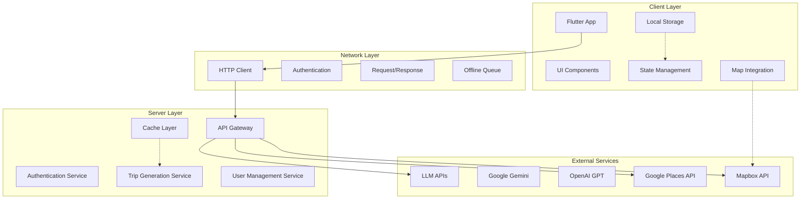
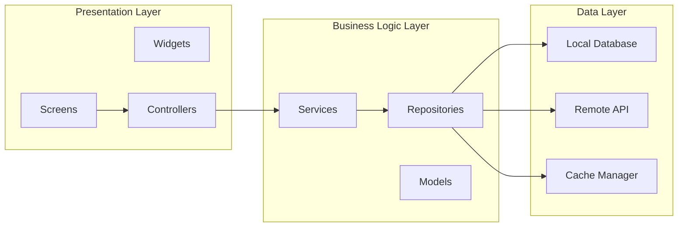
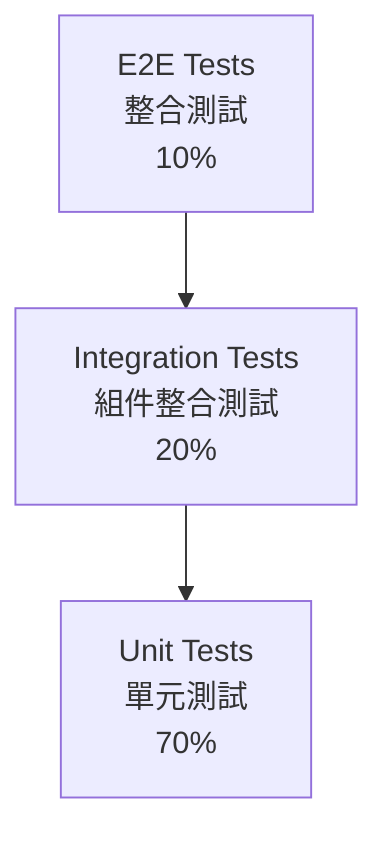
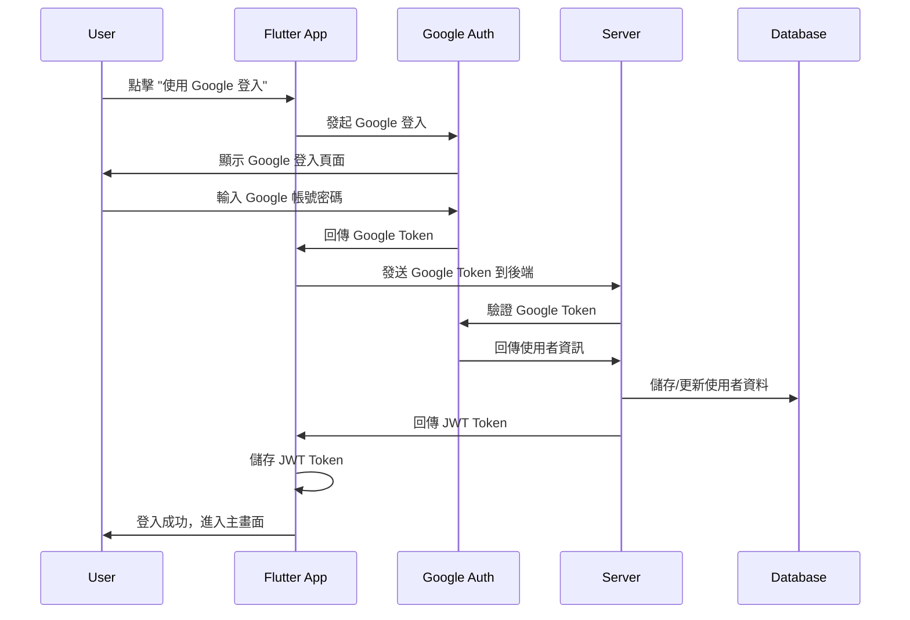
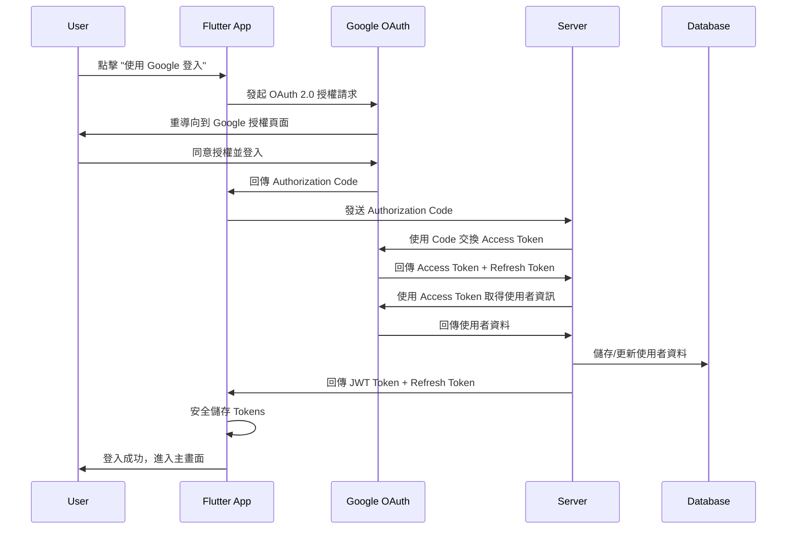

# Design Document

## Overview

TripMind 是一個基於 AI 的智能旅行規劃應用，採用三層架構設計：Flutter 客戶端、雲端 Server 和 LLM API。系統的核心設計理念是提供直觀的使用者體驗，透過自然語言描述生成個人化行程，並以精美的地圖和時間軸視圖呈現結果。

### 設計原則

1. **使用者優先**：簡化輸入流程，最大化輸出價值
2. **離線優先**：核心功能支援離線使用
3. **視覺導向**：地圖和時間軸提供直觀的行程理解
4. **個人化體驗**：基於自然語言分析提供客製化建議
5. **可擴展性**：為未來商業化功能預留設計空間

## Architecture

### 系統架構圖



### 技術棧選擇

**Frontend (Flutter)**
- **UI Framework**: Flutter 3.x (stable channel)
- **State Management**: Riverpod 2.x
- **HTTP Client**: Dio 5.x
- **Local Storage**: Hive 4.x (輕量級) + Flutter Secure Storage
- **Map Integration**: Mapbox GL Flutter
- **PDF Generation**: pdf + printing packages
- **Authentication**: google_sign_in + firebase_auth (Google 登入)

**Backend (建議)**
- **Runtime**: Node.js + Express 或 Python + FastAPI
- **Database**: PostgreSQL (主要) + Redis (快取)
- **Authentication**: JWT + bcrypt
- **File Storage**: AWS S3 或 Google Cloud Storage
- **Monitoring**: 日誌和錯誤追蹤

## Components and Interfaces

### 核心組件架構



### 主要組件設計

#### 1. Trip Generation Service

```dart
abstract class TripGenerationService {
  Future<Trip> generateTrip(TripRequest request);
  Future<PreferenceAnalysis> analyzeUserDescription(String description);
  Future<Trip> regenerateWithModifications(String tripId, String modifications);
}

class TripGenerationServiceImpl implements TripGenerationService {
  final ApiClient _apiClient;
  final CacheManager _cacheManager;
  
  @override
  Future<Trip> generateTrip(TripRequest request) async {
    // 1. 檢查快取
    final cacheKey = _generateCacheKey(request);
    final cachedTrip = await _cacheManager.get(cacheKey);
    if (cachedTrip != null) return cachedTrip;
    
    // 2. 發送請求到 Server
    final response = await _apiClient.post('/api/v1/generate-itinerary', 
      data: request.toJson());
    
    // 3. 解析回應並快取
    final trip = Trip.fromJson(response.data['trip']);
    await _cacheManager.set(cacheKey, trip);
    
    return trip;
  }
}
```

#### 2. Map Integration Component

```dart
class MapController extends StateNotifier<MapState> {
  final MapboxMapController _mapController;
  final LocationService _locationService;
  
  void showTrip(Trip trip) {
    // 1. 清除現有標記
    _clearMarkers();
    
    // 2. 為每日行程添加不同顏色的標記
    for (int dayIndex = 0; dayIndex < trip.days.length; dayIndex++) {
      final dayColor = _getDayColor(dayIndex);
      _addDayMarkers(trip.days[dayIndex], dayColor);
    }
    
    // 3. 添加路線 polyline
    _addRoutePolylines(trip);
    
    // 4. 調整視角以顯示所有景點
    _fitBoundsToTrip(trip);
  }
  
  void showDay(int dayIndex) {
    // 篩選顯示特定日期的景點和路線
    _filterMarkersForDay(dayIndex);
    _showDayRoute(dayIndex);
  }
}
```

#### 3. Timeline Component

```dart
class TimelineWidget extends ConsumerWidget {
  final Trip trip;
  
  @override
  Widget build(BuildContext context, WidgetRef ref) {
    return ListView.builder(
      itemCount: trip.days.length,
      itemBuilder: (context, dayIndex) {
        return DayTimelineCard(
          day: trip.days[dayIndex],
          onActivityTap: (activity) => _showActivityDetail(activity),
          onActivityDrag: (activity, newTimeSlot) => 
            _moveActivity(activity, newTimeSlot),
        );
      },
    );
  }
}

class DayTimelineCard extends StatelessWidget {
  final DayPlan day;
  final Function(Activity) onActivityTap;
  final Function(Activity, TimeSlot) onActivityDrag;
  
  @override
  Widget build(BuildContext context) {
    return Card(
      child: Column(
        children: [
          DayHeader(day: day),
          ...day.activities.map((activity) => 
            DraggableActivityCard(
              activity: activity,
              onTap: () => onActivityTap(activity),
              onDragEnd: (timeSlot) => onActivityDrag(activity, timeSlot),
            )
          ),
        ],
      ),
    );
  }
}
```

### 介面定義

#### Repository Interfaces

```dart
abstract class TripRepository {
  Future<List<Trip>> getAllTrips();
  Future<Trip?> getTripById(String id);
  Future<void> saveTrip(Trip trip);
  Future<void> deleteTrip(String id);
  Future<void> syncTrips();
}

abstract class UserRepository {
  Future<User?> getCurrentUser();
  Future<User> signInWithGoogle();
  Future<void> signOut();
  Future<bool> isSignedIn();
}

abstract class CacheRepository {
  Future<T?> get<T>(String key);
  Future<void> set<T>(String key, T value, {Duration? ttl});
  Future<void> remove(String key);
  Future<void> clear();
}
```

## Data Models

### 核心資料模型

```dart
@freezed
class Trip with _$Trip {
  const factory Trip({
    required String id,
    required String title,
    required Destination destination,
    required List<DayPlan> days,
    required UserPreferenceAnalysis preferenceAnalysis,
    required DateTime createdAt,
    required DateTime updatedAt,
    String? userId,
    String? generatedBy,
  }) = _Trip;
  
  factory Trip.fromJson(Map<String, dynamic> json) => _$TripFromJson(json);
}

@freezed
class DayPlan with _$DayPlan {
  const factory DayPlan({
    required int dayIndex,
    required DateTime date,
    required String theme,
    required List<Activity> activities,
  }) = _DayPlan;
  
  factory DayPlan.fromJson(Map<String, dynamic> json) => _$DayPlanFromJson(json);
}

@freezed
class Activity with _$Activity {
  const factory Activity({
    required String id,
    required String name,
    required String description,
    required double lat,
    required double lng,
    required String timeFrom,
    required String timeTo,
    required ActivityCategory category,
    required ActivityPriority priority,
    String? estimatedCost,
    String? tips,
    List<String>? photos,
  }) = _Activity;
  
  factory Activity.fromJson(Map<String, dynamic> json) => _$ActivityFromJson(json);
}

@freezed
class UserPreferenceAnalysis with _$UserPreferenceAnalysis {
  const factory UserPreferenceAnalysis({
    required String primaryFocus,
    required TravelPace travelPace,
    required List<String> interests,
    required List<String> avoidances,
    required String mood,
    required List<String> keywords,
  }) = _UserPreferenceAnalysis;
  
  factory UserPreferenceAnalysis.fromJson(Map<String, dynamic> json) => 
    _$UserPreferenceAnalysisFromJson(json);
}

enum ActivityCategory { food, sightseeing, culture, nature, shopping }
enum ActivityPriority { high, medium, low }
enum TravelPace { slow, medium, fast }
```

### 資料庫 Schema 設計

**設計目的與考量：**

1. **使用者管理** - 支援帳戶註冊、登入和行程所有權
2. **行程儲存** - 雲端同步使用者的行程資料
3. **分享功能** - 生成安全的分享連結供他人查看
4. **成本控制** - 追蹤 API 使用量，為未來商業化做準備
5. **資料分析** - 了解使用者行為和系統效能

```sql
-- Users table - Google 帳號登入管理
CREATE TABLE users (
  id UUID PRIMARY KEY DEFAULT gen_random_uuid(),
  google_id VARCHAR(255) UNIQUE NOT NULL,       -- Google 使用者 ID
  email VARCHAR(255) UNIQUE NOT NULL,           -- Google 帳號 email
  name VARCHAR(255),                            -- Google 使用者姓名
  avatar_url VARCHAR(500),                      -- Google 頭像 URL
  created_at TIMESTAMP DEFAULT NOW(),
  updated_at TIMESTAMP DEFAULT NOW()
);

-- Trips table - 行程資料儲存
CREATE TABLE trips (
  id UUID PRIMARY KEY DEFAULT gen_random_uuid(),
  user_id UUID REFERENCES users(id),           -- 行程所有者
  title VARCHAR(255) NOT NULL,                 -- 行程標題
  destination JSONB NOT NULL,                  -- 目的地資訊（彈性結構）
  preference_analysis JSONB,                   -- LLM 分析的使用者偏好
  days JSONB NOT NULL,                         -- 完整行程資料（彈性結構）
  generated_by VARCHAR(50),                    -- 使用的 LLM 模型
  created_at TIMESTAMP DEFAULT NOW(),
  updated_at TIMESTAMP DEFAULT NOW()
);

-- Trip sharing table - 分享連結管理
CREATE TABLE trip_shares (
  id UUID PRIMARY KEY DEFAULT gen_random_uuid(),
  trip_id UUID REFERENCES trips(id),
  share_token VARCHAR(255) UNIQUE NOT NULL,    -- 唯一分享 token
  is_active BOOLEAN DEFAULT TRUE,              -- 是否啟用分享
  created_at TIMESTAMP DEFAULT NOW(),
  expires_at TIMESTAMP                         -- 分享連結過期時間
);

-- API usage tracking - 成本和使用量追蹤
CREATE TABLE api_usage (
  id UUID PRIMARY KEY DEFAULT gen_random_uuid(),
  user_id UUID REFERENCES users(id),
  endpoint VARCHAR(255),                       -- API 端點
  tokens_used INTEGER,                         -- LLM token 使用量
  cost_usd DECIMAL(10,4),                     -- 成本（美元）
  created_at TIMESTAMP DEFAULT NOW()
);
```

**為什麼使用 JSONB 欄位？**
- `destination`、`preference_analysis`、`days` 使用 JSONB 是因為這些資料結構複雜且可能變化
- 避免過度正規化，保持查詢效能
- 支援 PostgreSQL 的 JSONB 索引和查詢功能
- 未來可以輕鬆擴展資料結構而不需要 schema 變更

**MVP 階段簡化考量：**
- 如果選擇 Guest 模式，可以暫時不使用 `users` 表
- 可以先用 Firebase Firestore 或 Supabase 快速建立後端
- `api_usage` 表在 MVP 階段可以選擇性實作

## Error Handling

### 錯誤分類與處理策略

```dart
abstract class AppException implements Exception {
  final String message;
  final String? code;
  final bool isRetryable;
  
  const AppException(this.message, {this.code, this.isRetryable = false});
}

class NetworkException extends AppException {
  const NetworkException(String message) : 
    super(message, code: 'NETWORK_ERROR', isRetryable: true);
}

class LLMGenerationException extends AppException {
  const LLMGenerationException(String message) : 
    super(message, code: 'LLM_GENERATION_FAILED', isRetryable: true);
}

class ValidationException extends AppException {
  const ValidationException(String message) : 
    super(message, code: 'VALIDATION_ERROR', isRetryable: false);
}

class RateLimitException extends AppException {
  final int retryAfterSeconds;
  
  const RateLimitException(String message, this.retryAfterSeconds) : 
    super(message, code: 'RATE_LIMIT_EXCEEDED', isRetryable: true);
}
```

### 錯誤處理中介軟體

```dart
class ErrorHandler {
  static void handleError(AppException error, WidgetRef ref) {
    final messenger = ScaffoldMessenger.of(ref.context);
    
    switch (error.runtimeType) {
      case NetworkException:
        _showRetryableError(messenger, error);
        break;
      case RateLimitException:
        final rateLimitError = error as RateLimitException;
        _showRateLimitError(messenger, rateLimitError);
        break;
      case ValidationException:
        _showValidationError(messenger, error);
        break;
      default:
        _showGenericError(messenger, error);
    }
  }
  
  static void _showRetryableError(ScaffoldMessengerState messenger, AppException error) {
    messenger.showSnackBar(
      SnackBar(
        content: Text(error.message),
        action: SnackBarAction(
          label: '重試',
          onPressed: () => _retryLastAction(),
        ),
      ),
    );
  }
}
```

## Testing Strategy

### 測試金字塔



### 測試策略

#### 1. Unit Tests (70%)

```dart
// Model 測試
group('Trip Model Tests', () {
  test('should create trip from valid JSON', () {
    final json = {
      'id': 'test-id',
      'title': 'Test Trip',
      'destination': {...},
      'days': [...],
      // ...
    };
    
    final trip = Trip.fromJson(json);
    
    expect(trip.id, equals('test-id'));
    expect(trip.title, equals('Test Trip'));
  });
});

// Service 測試
group('TripGenerationService Tests', () {
  late TripGenerationService service;
  late MockApiClient mockApiClient;
  
  setUp(() {
    mockApiClient = MockApiClient();
    service = TripGenerationServiceImpl(mockApiClient);
  });
  
  test('should generate trip successfully', () async {
    when(mockApiClient.post(any, data: anyNamed('data')))
      .thenAnswer((_) async => Response(data: mockTripResponse));
    
    final request = TripRequest(...);
    final trip = await service.generateTrip(request);
    
    expect(trip, isA<Trip>());
    verify(mockApiClient.post('/api/v1/generate-itinerary', data: any));
  });
});
```

#### 2. Widget Tests (20%)

```dart
group('Timeline Widget Tests', () {
  testWidgets('should display all activities', (tester) async {
    final mockTrip = Trip(...);
    
    await tester.pumpWidget(
      MaterialApp(
        home: TimelineWidget(trip: mockTrip),
      ),
    );
    
    expect(find.byType(DayTimelineCard), findsNWidgets(mockTrip.days.length));
    expect(find.text(mockTrip.days.first.activities.first.name), findsOneWidget);
  });
  
  testWidgets('should handle activity tap', (tester) async {
    bool activityTapped = false;
    final mockTrip = Trip(...);
    
    await tester.pumpWidget(
      MaterialApp(
        home: TimelineWidget(
          trip: mockTrip,
          onActivityTap: (_) => activityTapped = true,
        ),
      ),
    );
    
    await tester.tap(find.byType(ActivityCard).first);
    await tester.pump();
    
    expect(activityTapped, isTrue);
  });
});
```

#### 3. Integration Tests (10%)

```dart
group('Trip Generation Flow', () {
  testWidgets('complete trip generation flow', (tester) async {
    await tester.pumpWidget(MyApp());
    
    // 1. 導航到建立行程頁面
    await tester.tap(find.byIcon(Icons.add));
    await tester.pumpAndSettle();
    
    // 2. 填寫行程資訊
    await tester.enterText(find.byKey(Key('destination_field')), '台北');
    await tester.enterText(find.byKey(Key('description_field')), '美食之旅');
    
    // 3. 點擊生成按鈕
    await tester.tap(find.text('智能生成行程'));
    await tester.pumpAndSettle();
    
    // 4. 驗證結果頁面
    expect(find.byType(MapView), findsOneWidget);
    expect(find.byType(TimelineView), findsOneWidget);
  });
});
```

### 測試工具與設定

```yaml
# pubspec.yaml
dev_dependencies:
  flutter_test:
    sdk: flutter
  mockito: ^5.4.0
  build_runner: ^2.4.0
  integration_test:
    sdk: flutter
  patrol: ^2.0.0  # 進階 E2E 測試
```

## 效能最佳化策略

### 1. 應用啟動最佳化

```dart
class AppInitializer {
  static Future<void> initialize() async {
    // 並行初始化非關鍵服務
    await Future.wait([
      _initializeLocalStorage(),
      _initializeNetworking(),
      _preloadCriticalData(),
    ]);
    
    // 延遲初始化非關鍵服務
    unawaited(_initializeAnalytics());
    unawaited(_initializeNotifications());
  }
}
```

### 2. 地圖效能最佳化

```dart
class MapPerformanceOptimizer {
  static const int MAX_VISIBLE_MARKERS = 50;
  static const double CLUSTER_DISTANCE = 50.0;
  
  void optimizeMarkers(List<Activity> activities) {
    // 1. 標記聚合
    final clusteredMarkers = _clusterNearbyMarkers(activities);
    
    // 2. 視窗裁剪
    final visibleMarkers = _getVisibleMarkers(clusteredMarkers);
    
    // 3. LOD (Level of Detail)
    final optimizedMarkers = _applyLevelOfDetail(visibleMarkers);
    
    _updateMapMarkers(optimizedMarkers);
  }
}
```

### 3. 記憶體管理

```dart
class MemoryManager {
  static const int MAX_CACHED_TRIPS = 10;
  static const Duration CACHE_TTL = Duration(hours: 24);
  
  void manageCache() {
    // 1. LRU 快取清理
    _cleanupLRUCache();
    
    // 2. 圖片記憶體管理
    _optimizeImageCache();
    
    // 3. 定期垃圾回收
    _scheduleGarbageCollection();
  }
}
```

這個設計文件涵蓋了 TripMind 應用的核心架構、組件設計、資料模型、錯誤處理和測試策略。設計重點在於提供良好的使用者體驗，同時保持系統的可維護性和可擴展性。
## Goo
gle 登入整合設計

### Google 登入流程



### Google 登入實作

```dart
class GoogleAuthService {
  final GoogleSignIn _googleSignIn = GoogleSignIn(
    scopes: ['email', 'profile'],
  );
  final FirebaseAuth _firebaseAuth = FirebaseAuth.instance;

  Future<User> signInWithGoogle() async {
    try {
      // 1. Google 登入
      final GoogleSignInAccount? googleUser = await _googleSignIn.signIn();
      if (googleUser == null) throw Exception('Google 登入被取消');

      // 2. 取得 Google 認證資訊
      final GoogleSignInAuthentication googleAuth = 
        await googleUser.authentication;

      // 3. 建立 Firebase 認證憑證
      final credential = GoogleAuthProvider.credential(
        accessToken: googleAuth.accessToken,
        idToken: googleAuth.idToken,
      );

      // 4. Firebase 登入
      final UserCredential userCredential = 
        await _firebaseAuth.signInWithCredential(credential);

      // 5. 建立使用者物件
      final user = User(
        id: userCredential.user!.uid,
        googleId: userCredential.user!.uid,
        email: userCredential.user!.email!,
        name: userCredential.user!.displayName ?? '',
        avatarUrl: userCredential.user!.photoURL,
      );

      // 6. 同步到後端
      await _syncUserToBackend(user);

      return user;
    } catch (e) {
      throw AuthException('Google 登入失敗: ${e.toString()}');
    }
  }

  Future<void> _syncUserToBackend(User user) async {
    final idToken = await _firebaseAuth.currentUser?.getIdToken();
    
    await _apiClient.post('/api/v1/auth/google', data: {
      'idToken': idToken,
      'user': user.toJson(),
    });
  }

  Future<void> signOut() async {
    await Future.wait([
      _googleSignIn.signOut(),
      _firebaseAuth.signOut(),
    ]);
  }
}
```

### 後端 Google Token 驗證

```javascript
// Node.js + Express 範例
const admin = require('firebase-admin');

app.post('/api/v1/auth/google', async (req, res) => {
  try {
    const { idToken, user } = req.body;
    
    // 1. 驗證 Firebase ID Token
    const decodedToken = await admin.auth().verifyIdToken(idToken);
    const googleId = decodedToken.uid;
    
    // 2. 檢查使用者是否已存在
    let existingUser = await db.query(
      'SELECT * FROM users WHERE google_id = $1', 
      [googleId]
    );
    
    if (existingUser.rows.length === 0) {
      // 3. 建立新使用者
      await db.query(`
        INSERT INTO users (google_id, email, name, avatar_url) 
        VALUES ($1, $2, $3, $4)
      `, [googleId, user.email, user.name, user.avatarUrl]);
    } else {
      // 4. 更新現有使用者資訊
      await db.query(`
        UPDATE users 
        SET email = $2, name = $3, avatar_url = $4, updated_at = NOW()
        WHERE google_id = $1
      `, [googleId, user.email, user.name, user.avatarUrl]);
    }
    
    // 5. 生成 JWT Token
    const jwtToken = jwt.sign(
      { userId: googleId, email: user.email },
      process.env.JWT_SECRET,
      { expiresIn: '30d' }
    );
    
    res.json({ 
      success: true, 
      token: jwtToken,
      user: user 
    });
    
  } catch (error) {
    res.status(401).json({ 
      success: false, 
      error: 'Google 登入驗證失敗' 
    });
  }
});
```

### 使用者體驗設計

```dart
class AuthScreen extends ConsumerWidget {
  @override
  Widget build(BuildContext context, WidgetRef ref) {
    return Scaffold(
      body: Center(
        child: Column(
          mainAxisAlignment: MainAxisAlignment.center,
          children: [
            // App Logo
            Image.asset('assets/logo.png', height: 120),
            
            SizedBox(height: 32),
            
            // App 標題和描述
            Text(
              'TripMind',
              style: Theme.of(context).textTheme.headlineLarge,
            ),
            
            SizedBox(height: 16),
            
            Text(
              'AI 智能旅行規劃助手',
              style: Theme.of(context).textTheme.bodyLarge,
              textAlign: TextAlign.center,
            ),
            
            SizedBox(height: 48),
            
            // Google 登入按鈕
            ElevatedButton.icon(
              onPressed: () => _signInWithGoogle(ref),
              icon: Image.asset('assets/google_logo.png', height: 24),
              label: Text('使用 Google 帳號登入'),
              style: ElevatedButton.styleFrom(
                padding: EdgeInsets.symmetric(horizontal: 24, vertical: 12),
                shape: RoundedRectangleBorder(
                  borderRadius: BorderRadius.circular(8),
                ),
              ),
            ),
            
            SizedBox(height: 16),
            
            // Guest 模式按鈕
            TextButton(
              onPressed: () => _continueAsGuest(context),
              child: Text('暫不登入，以訪客身份使用'),
            ),
            
            SizedBox(height: 32),
            
            // 隱私條款
            Text(
              '登入即表示同意我們的服務條款和隱私政策',
              style: Theme.of(context).textTheme.bodySmall,
              textAlign: TextAlign.center,
            ),
          ],
        ),
      ),
    );
  }
  
  Future<void> _signInWithGoogle(WidgetRef ref) async {
    try {
      final authService = ref.read(authServiceProvider);
      await authService.signInWithGoogle();
      
      // 登入成功，導航到主畫面
      Navigator.of(context).pushReplacementNamed('/home');
    } catch (e) {
      ScaffoldMessenger.of(context).showSnackBar(
        SnackBar(content: Text('登入失敗: ${e.toString()}')),
      );
    }
  }
}
```

### 安全性考量

1. **Token 安全**：使用 Firebase ID Token 驗證，避免直接處理 Google Access Token
2. **資料加密**：敏感資料使用 Flutter Secure Storage 加密儲存
3. **Token 過期**：JWT Token 設定合理的過期時間（30天）
4. **自動登出**：Token 過期時自動登出並要求重新登入
5. **隱私保護**：明確告知使用者資料使用方式

### 依賴套件

```yaml
dependencies:
  google_sign_in: ^6.1.5
  firebase_auth: ^4.10.1
  firebase_core: ^2.17.0
  
dev_dependencies:
  firebase_auth_mocks: ^0.13.0  # 測試用
```#
# OAuth 2.0 Google 登入整合設計

### OAuth 2.0 認證流程



### OAuth 2.0 實作設計

#### 1. Flutter 客戶端實作

```dart
class OAuth2GoogleService {
  static const String _clientId = 'YOUR_GOOGLE_CLIENT_ID';
  static const String _redirectUri = 'com.tripmind.app://oauth/callback';
  static const List<String> _scopes = ['openid', 'email', 'profile'];
  
  final Dio _dio = Dio();
  final FlutterSecureStorage _secureStorage = FlutterSecureStorage();

  Future<User> signInWithGoogle() async {
    try {
      // 1. 建構 OAuth 2.0 授權 URL
      final authUrl = _buildAuthUrl();
      
      // 2. 開啟瀏覽器進行授權
      final result = await FlutterWebAuth.authenticate(
        url: authUrl,
        callbackUrlScheme: 'com.tripmind.app',
      );
      
      // 3. 從回調 URL 提取 authorization code
      final code = _extractCodeFromCallback(result);
      
      // 4. 發送 code 到後端交換 tokens
      final response = await _dio.post('/api/v1/auth/oauth/google', data: {
        'code': code,
        'redirect_uri': _redirectUri,
      });
      
      // 5. 儲存 tokens
      final tokens = response.data;
      await _secureStorage.write(key: 'jwt_token', value: tokens['jwt_token']);
      await _secureStorage.write(key: 'refresh_token', value: tokens['refresh_token']);
      
      // 6. 回傳使用者資訊
      return User.fromJson(tokens['user']);
      
    } catch (e) {
      throw AuthException('OAuth 2.0 登入失敗: ${e.toString()}');
    }
  }

  String _buildAuthUrl() {
    final params = {
      'client_id': _clientId,
      'redirect_uri': _redirectUri,
      'response_type': 'code',
      'scope': _scopes.join(' '),
      'access_type': 'offline',
      'prompt': 'consent',
      'state': _generateState(), // CSRF 保護
    };
    
    final query = params.entries
        .map((e) => '${Uri.encodeComponent(e.key)}=${Uri.encodeComponent(e.value)}')
        .join('&');
    
    return 'https://accounts.google.com/o/oauth2/v2/auth?$query';
  }

  String _extractCodeFromCallback(String callbackUrl) {
    final uri = Uri.parse(callbackUrl);
    final code = uri.queryParameters['code'];
    final state = uri.queryParameters['state'];
    
    // 驗證 state 參數防止 CSRF 攻擊
    if (!_validateState(state)) {
      throw AuthException('Invalid state parameter');
    }
    
    if (code == null) {
      throw AuthException('Authorization code not found');
    }
    
    return code;
  }

  Future<void> refreshToken() async {
    final refreshToken = await _secureStorage.read(key: 'refresh_token');
    if (refreshToken == null) throw AuthException('No refresh token found');
    
    final response = await _dio.post('/api/v1/auth/refresh', data: {
      'refresh_token': refreshToken,
    });
    
    final tokens = response.data;
    await _secureStorage.write(key: 'jwt_token', value: tokens['jwt_token']);
  }

  Future<void> signOut() async {
    await _secureStorage.deleteAll();
  }
}
```

#### 2. 後端 OAuth 2.0 處理

```javascript
// Node.js + Express 實作
const axios = require('axios');
const jwt = require('jsonwebtoken');

app.post('/api/v1/auth/oauth/google', async (req, res) => {
  try {
    const { code, redirect_uri } = req.body;
    
    // 1. 使用 authorization code 交換 access token
    const tokenResponse = await axios.post('https://oauth2.googleapis.com/token', {
      client_id: process.env.GOOGLE_CLIENT_ID,
      client_secret: process.env.GOOGLE_CLIENT_SECRET,
      code: code,
      grant_type: 'authorization_code',
      redirect_uri: redirect_uri,
    });
    
    const { access_token, refresh_token } = tokenResponse.data;
    
    // 2. 使用 access token 取得使用者資訊
    const userResponse = await axios.get('https://www.googleapis.com/oauth2/v2/userinfo', {
      headers: {
        'Authorization': `Bearer ${access_token}`,
      },
    });
    
    const googleUser = userResponse.data;
    
    // 3. 檢查使用者是否已存在
    let user = await db.query(
      'SELECT * FROM users WHERE google_id = $1', 
      [googleUser.id]
    );
    
    if (user.rows.length === 0) {
      // 4. 建立新使用者
      const result = await db.query(`
        INSERT INTO users (google_id, email, name, avatar_url) 
        VALUES ($1, $2, $3, $4) RETURNING *
      `, [googleUser.id, googleUser.email, googleUser.name, googleUser.picture]);
      
      user = result;
    } else {
      // 5. 更新現有使用者資訊
      const result = await db.query(`
        UPDATE users 
        SET email = $2, name = $3, avatar_url = $4, updated_at = NOW()
        WHERE google_id = $1 RETURNING *
      `, [googleUser.id, googleUser.email, googleUser.name, googleUser.picture]);
      
      user = result;
    }
    
    // 6. 儲存 refresh token（加密）
    await db.query(`
      INSERT INTO user_tokens (user_id, refresh_token, expires_at)
      VALUES ($1, $2, $3)
      ON CONFLICT (user_id) DO UPDATE SET 
        refresh_token = $2, expires_at = $3, updated_at = NOW()
    `, [user.rows[0].id, encrypt(refresh_token), new Date(Date.now() + 30 * 24 * 60 * 60 * 1000)]);
    
    // 7. 生成 JWT token
    const jwtToken = jwt.sign(
      { 
        userId: user.rows[0].id,
        googleId: googleUser.id,
        email: googleUser.email 
      },
      process.env.JWT_SECRET,
      { expiresIn: '24h' }
    );
    
    // 8. 生成應用層 refresh token
    const appRefreshToken = jwt.sign(
      { userId: user.rows[0].id },
      process.env.REFRESH_TOKEN_SECRET,
      { expiresIn: '30d' }
    );
    
    res.json({
      success: true,
      jwt_token: jwtToken,
      refresh_token: appRefreshToken,
      user: {
        id: user.rows[0].id,
        googleId: googleUser.id,
        email: googleUser.email,
        name: googleUser.name,
        avatarUrl: googleUser.picture,
      }
    });
    
  } catch (error) {
    console.error('OAuth error:', error);
    res.status(401).json({
      success: false,
      error: 'OAuth 2.0 認證失敗'
    });
  }
});

// Token 刷新端點
app.post('/api/v1/auth/refresh', async (req, res) => {
  try {
    const { refresh_token } = req.body;
    
    // 驗證 refresh token
    const decoded = jwt.verify(refresh_token, process.env.REFRESH_TOKEN_SECRET);
    
    // 取得使用者資訊
    const user = await db.query('SELECT * FROM users WHERE id = $1', [decoded.userId]);
    if (user.rows.length === 0) {
      return res.status(401).json({ error: 'User not found' });
    }
    
    // 生成新的 JWT token
    const newJwtToken = jwt.sign(
      { 
        userId: user.rows[0].id,
        googleId: user.rows[0].google_id,
        email: user.rows[0].email 
      },
      process.env.JWT_SECRET,
      { expiresIn: '24h' }
    );
    
    res.json({
      success: true,
      jwt_token: newJwtToken
    });
    
  } catch (error) {
    res.status(401).json({ error: 'Invalid refresh token' });
  }
});
```

#### 3. 資料庫 Schema 更新

```sql
-- 新增 token 儲存表
CREATE TABLE user_tokens (
  id UUID PRIMARY KEY DEFAULT gen_random_uuid(),
  user_id UUID REFERENCES users(id) ON DELETE CASCADE,
  refresh_token TEXT NOT NULL,  -- 加密儲存的 Google refresh token
  expires_at TIMESTAMP NOT NULL,
  created_at TIMESTAMP DEFAULT NOW(),
  updated_at TIMESTAMP DEFAULT NOW(),
  UNIQUE(user_id)
);

-- 新增索引
CREATE INDEX idx_user_tokens_user_id ON user_tokens(user_id);
CREATE INDEX idx_user_tokens_expires_at ON user_tokens(expires_at);
```

### OAuth 2.0 安全性最佳實踐

#### 1. PKCE (Proof Key for Code Exchange)

```dart
class PKCEHelper {
  static String generateCodeVerifier() {
    final random = Random.secure();
    final bytes = List<int>.generate(32, (i) => random.nextInt(256));
    return base64UrlEncode(bytes).replaceAll('=', '');
  }
  
  static String generateCodeChallenge(String codeVerifier) {
    final bytes = utf8.encode(codeVerifier);
    final digest = sha256.convert(bytes);
    return base64UrlEncode(digest.bytes).replaceAll('=', '');
  }
}
```

#### 2. State 參數驗證

```dart
class StateManager {
  static final Map<String, DateTime> _states = {};
  
  static String generateState() {
    final state = Uuid().v4();
    _states[state] = DateTime.now().add(Duration(minutes: 10));
    return state;
  }
  
  static bool validateState(String? state) {
    if (state == null || !_states.containsKey(state)) return false;
    
    final expiry = _states[state]!;
    if (DateTime.now().isAfter(expiry)) {
      _states.remove(state);
      return false;
    }
    
    _states.remove(state);
    return true;
  }
}
```

#### 3. Token 安全儲存

```dart
class SecureTokenStorage {
  static const FlutterSecureStorage _storage = FlutterSecureStorage(
    aOptions: AndroidOptions(
      encryptedSharedPreferences: true,
    ),
    iOptions: IOSOptions(
      accessibility: IOSAccessibility.first_unlock_this_device,
    ),
  );
  
  static Future<void> storeTokens({
    required String jwtToken,
    required String refreshToken,
  }) async {
    await Future.wait([
      _storage.write(key: 'jwt_token', value: jwtToken),
      _storage.write(key: 'refresh_token', value: refreshToken),
      _storage.write(key: 'token_timestamp', value: DateTime.now().toIso8601String()),
    ]);
  }
  
  static Future<Map<String, String?>> getTokens() async {
    return {
      'jwt_token': await _storage.read(key: 'jwt_token'),
      'refresh_token': await _storage.read(key: 'refresh_token'),
      'token_timestamp': await _storage.read(key: 'token_timestamp'),
    };
  }
}
```

### 依賴套件

```yaml
dependencies:
  flutter_web_auth: ^0.5.0
  dio: ^5.3.2
  flutter_secure_storage: ^9.0.0
  crypto: ^3.0.3
  uuid: ^4.0.0
  
dev_dependencies:
  mockito: ^5.4.0
```

### OAuth 2.0 優勢

1. **標準化**：遵循 OAuth 2.0 標準，具有良好的互操作性
2. **安全性**：支援 PKCE、state 參數等安全機制
3. **Token 管理**：分離 access token 和 refresh token
4. **可擴展性**：未來可以輕鬆支援其他 OAuth 提供商
5. **細粒度權限**：可以精確控制請求的權限範圍